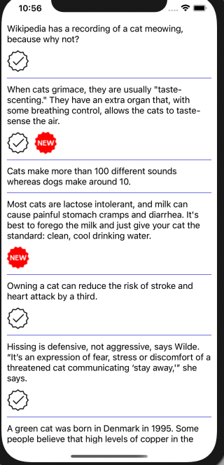

# CatFacts

Take-home coding exercise for Entrust (Onfido iOS SDK team): an iOS app that displays a list of facts about cats.



The screenshot is a guide.

## Requirements

### Features

- [ ] A scrollable list of facts about cats.
- [ ] A checkbox icon on facts where the API returns `verified: true`.
- [ ] A "new" icon on facts created within the last 90 days.
- [ ] Unit tests.
- [ ] A simple search box that filters facts by keyword.

### Quality expectations

Treat it as a production-quality application, not just the minimum requirements. The review will focus on:

- Application architecture and design decisions
- Code quality, maintainability and readability
- Error handling and edge cases
- Test coverage and testing strategy
- Scalability and extensibility
- User experience
- Any additional enhancements that add value

Going beyond the requested features is encouraged. Every design decision and trade-off should be ready to discuss in the follow-up review session.

## Starting point

The [skeleton project](https://drive.google.com/file/d/1e55YL9S5BFbbVAeZgtbdfCIGenGx8Spr/view?usp=sharing) provides:

| Path                               | Contents                                                            |
| ---------------------------------- | ------------------------------------------------------------------- |
| `CatFacts/API/Cat.swift`           | `CatFact` and `Status` models (`Decodable`)                         |
| `CatFacts/API/FactsApi.swift`      | `getFacts(completion:)` using Alamofire, plus a custom date decoder |
| `CatFacts/ViewController.swift`    | Empty view controller backed by `Main.storyboard`                   |
| `CatFacts/Assets.xcassets`         | `verified` and `new` badge images                                   |
| `CatFactsTests`, `CatFactsUITests` | Xcode test templates, no real tests                                 |
| `Podfile`, `Pods/`                 | Alamofire ~> 5.2 via CocoaPods                                      |
| `archive.sh`                       | Zips the `main` branch into `CatFacts.zip` for submission           |

## API

`GET https://api.npoint.io/18962a8a5d00e62a8d2a` returns a JSON array of facts:

```json
{
  "_id": "66ac00000000000000000001",
  "text": "Cats can rotate each ear independently…",
  "status": { "verified": true, "sentCount": 128 },
  "createdAt": "2022-06-29T09:15:00 +0000"
}
```

Notes:

- `createdAt` uses `yyyy-MM-dd'T'HH:mm:ss Z`, not strict ISO 8601.
- All 50 facts were created between 2020-05-17 and 2022-06-29, so none qualify as "new" against today's date. The "new" badge needs a way to control the reference date to be demonstrable.

## Submission

Commit all work to `main`, then run:

```bash
./archive.sh
```

This produces `CatFacts.zip` from the committed tree (uncommitted changes are not included).
